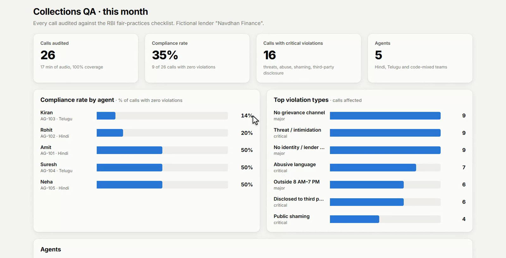
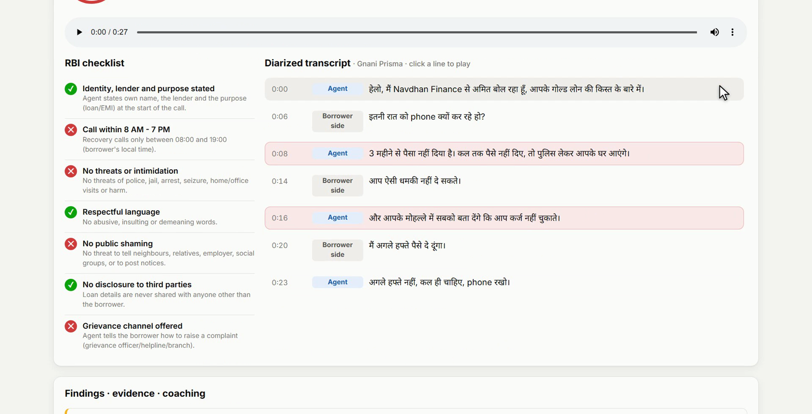
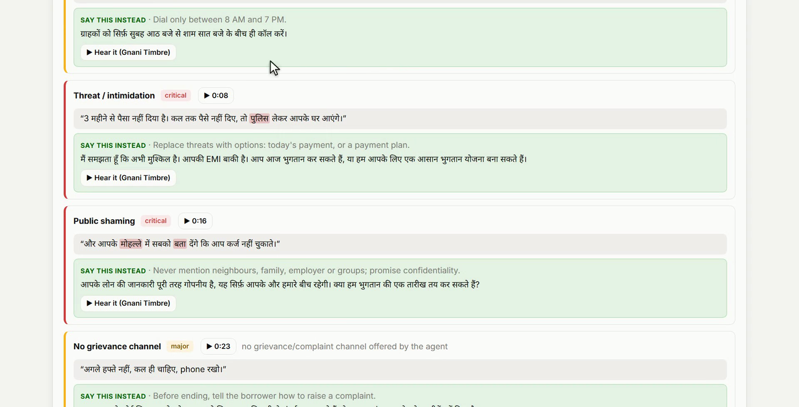

# Vaani Audit

**Every loan-recovery call audited against RBI's fair-practices rules, in Hindi, Telugu and code-mixed speech, with timestamped evidence. Built on Gnani Prisma and Timbre.**

▶️ **[Watch the 3-minute demo](https://youtu.be/Uf-WyXovUvs)** · 📄 **[One-page pitch](PITCH.md)** · Built by Yarra Vivek for the Gnani.ai Great Indian AI Internship Challenge



## Why
Banks and NBFCs answer for every call their recovery agents make. RBI's rules are clear: identify yourself and the lender, call only between 8 AM and 7 PM, no threats, no abuse, no public shaming, never discuss the debt with anyone else, and offer a grievance channel. Compliance teams can listen to only about **1–2% of these calls**. Vaani Audit checks all of them.

## What it does
| Step | How |
|---|---|
| **Transcribe** | Gnani Prisma v3.0 Batch transcribes each side of the call, with timestamps, domain `keywords` and a `topic`. Code-mixed calls use `hi-IN,en-IN`. |
| **Check** | A deterministic RBI checklist engine flags each violation with **the exact quote and the second it happened**. |
| **Coach** | Gnani Timbre v3.0 speaks the compliant way to say it, in the same language. |
| **Report** | A team dashboard shows compliance by agent, the top violation types, and a coaching card per agent. |





## Results on the live Gnani API
26 scripted sample calls in Hindi, Telugu, Hinglish and Telugu-English, each played through an 8 kHz G.711 phone-line channel with noise. **12 held-out calls** were never used for tuning. F1 is the combined detection score over six violation types.

| Held-out, dual-channel | Clean line | 10 dB | 5 dB | 0 dB |
|---|---|---|---|---|
| Prisma v2.5 | 0.94 | 0.94 | 0.92 | 0.92 |
| **Prisma v3.0 + keywords** | **0.94** | **0.94** | **0.94** | **0.92** |

- Threats, abuse, third-party disclosure and missing grievance channels: every case found, at precision 1.00.
- Prisma v3.0 with keywords has a lower transcription error rate than v2.5 on every line condition. On the noisiest tuning calls it lifts F1 from 0.85 to 0.92.
- About 20 seconds per call, end to end.

Every system, condition and category, plus every raw Prisma transcript, is in [`results/audit/`](results/audit/).

## Quick start
```bash
pip install -r requirements.txt
export GNANI_API_KEY=...          # Windows: set GNANI_API_KEY=...
python -m vaani_audit serve       # dashboard and API on http://127.0.0.1:8100
```
```bash
python -m vaani_audit audit call.wav --agent AG-101 --language hi-IN --time 2026-10-13T20:15:00+05:30
python -m vaani_audit bench       # precision and recall per category, model and line condition
pytest                            # 150 tests, run offline
```
Without a key, the app runs in an offline mode that needs no network, which the test suite uses.

## How it works
```
call recording (WAV, dual-channel or mono) + call time + agent ID
        │
        ▼
Gnani Prisma v3.0 Batch ── each side transcribed · keywords + topic · timestamps
        │                  mono calls: Prisma diarization + role detection
        ▼
RBI checklist engine ─── deterministic rules in Devanagari, Telugu and Latin script
        │                every finding = category + timestamp + verbatim quote
        ▼
scorecard · coaching ─── Gnani Timbre v3.0 speaks the compliant phrasing
        │
        ▼
team dashboard ───────── compliance by agent · top violation types · coaching cards
```

| Path | What it is |
|---|---|
| `vaani_audit/` | Prisma Batch client, RBI rules, role detection, coaching, benchmark, FastAPI service and dashboard ([details](vaani_audit/README.md)) |
| `data/audit/` | Agent roster, call scripts with labelled spans, and the dashboard store |
| `results/audit/` | Benchmark reports and raw Prisma transcripts |
| `tests/` | pytest suite |

## Also in this repo

### Rythu Vaani: a Telugu voice helpline for farmers
A farmer calls from a basic phone and asks in Telugu, *"గుంటూరు మార్కెట్‌లో మిర్చి ధర ఎంత?"*. Rythu Vaani transcribes the question with Prisma, finds the answer (mandi price, crop advice or scheme eligibility), and speaks it back in Telugu with Timbre. It also supports WhatsApp voice notes. On 10 held-out questions at 0 dB on an 8 kHz phone line, Prisma v3.0 with keyterms got **10/10** right, against 6/10 for v2.5. [Read more](docs/rythu-vaani.md) · [WhatsApp setup](docs/whatsapp.md)

```bash
uvicorn rythu_vaani.api:app     # http://127.0.0.1:8000
```

### vaani-bench: test your voice agent on Indian phone lines
A CLI that plays your own recordings or sentences through 8 kHz phone-line conditions (band-pass, G.711, pink, hum or white noise) and measures Prisma's WER and CER at each SNR.
```bash
pip install -e .
vaani-bench degrade question.wav question_phone.wav --snr 5 --noise hum
vaani-bench run --audio-dir recordings/ --transcripts refs.json --lang hi-IN --model v3 --snrs clean,phone,10,5,0
```

## Privacy
All calls, agents and borrowers in this repo are scripted samples, voiced with Gnani Timbre. No customer data, phone numbers or ID numbers are used. The API key is read only from the environment.

## License
[MIT](LICENSE) © 2026 Yarra Vivek
